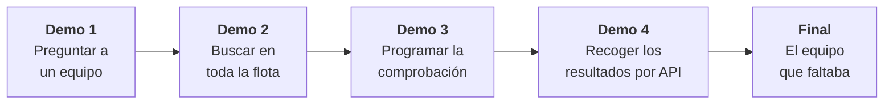
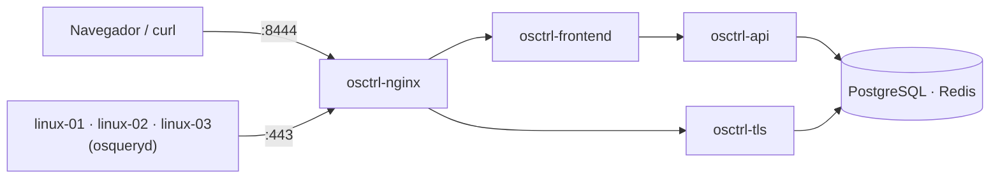

<div align="center">


# Detección de amenazas a escala con osctrl

**Un proceso se ejecuta desde `/tmp` en un equipo. ¿En cuántos más?**

Taller práctico de 60 minutos · [Conand 2026](https://conand.ad) · Javier Marcos


[Diapositivas (PDF)](slides.pdf) · [Empezar](#empezar-en-un-minuto) · [El incidente](#el-incidente) · [Las cuatro demos](#paso-a-paso-las-cuatro-demos) · [Más consultas](#más-consultas-para-investigar-en-linux) · [Atajos](#operar-el-laboratorio)

</div>

---

Tienes una pista: algo se ejecuta desde una carpeta temporal. Con [osquery](https://osquery.io) se lo preguntas a un equipo en SQL. Con [osctrl](https://osctrl.net) se lo preguntas a **toda la flota**, lo dejas programado y recoges las respuestas por API.

Este repositorio trae un laboratorio completo que arranca con un comando en tu portátil: un servidor osctrl y tres equipos Linux inscritos, dos de ellos «comprometidos». Sin nube, sin cuentas y sin malware de verdad.

## Qué vas a hacer



| | Aprenderás a… | Herramienta |
|---|---|---|
| **Demo 1** | Investigar un proceso sospechoso con SQL: quién lo lanzó, con quién habla, desde cuándo | `osqueryi` |
| **Demo 2** | Lanzar la misma pregunta a todos los equipos y leer bien la respuesta: fila, cero filas o silencio | Interfaz de osctrl |
| **Demo 3** | Convertir la pregunta en una comprobación continua para toda la flota | Consultas programadas |
| **Demo 4** | Automatizar: descargar los resultados con `curl` y `jq` | API de osctrl |

> [!TIP]
> Todo lo que se escribe en el taller está aquí, listo para copiar. No hace falta apuntar nada. Las diapositivas están en [`slides.pdf`](slides.pdf).

## Empezar en un minuto

Necesitas Docker con Compose v2 (Docker Desktop, OrbStack o Docker Engine, en arm64 o amd64), unos 3 GB de disco y el puerto `8444` libre. Internet solo hace falta la primera vez, para descargar las imágenes.

```bash
git clone https://github.com/jmpsec/conand-devfest-2026-osctrl.git
```

```bash
cd conand-devfest-2026-osctrl
```

```bash
make up
```

¿No tienes `make`? `cd incident && docker compose up -d --build` hace lo mismo.

En menos de un minuto tienes osctrl funcionando:

| | |
|---|---|
| **Interfaz web** | <https://localhost:8444> (certificado autofirmado: acepta el aviso del navegador) |
| **Usuario** | `admin` |
| **Contraseña** | `conand` |
| **Entorno** | `conand` |
| **API** | `https://localhost:8444/api/v1/...` |

> [!IMPORTANT]
> Comprueba que los tres equipos aparecen en **Nodes** y espera unos 30 segundos antes de lanzar consultas: osctrl solo envía consultas a los equipos que ya se han comunicado con el servidor.

## El incidente

| Equipo | Estado | Qué hay |
|---|---|---|
| `linux-01` | 🔴 Comprometido | `/tmp/conand-demo` en ejecución |
| `linux-02` | 🟢 Limpio | Nada en `/tmp` (en la demo 3 se crea `/tmp/conand-demo-2`) |
| `linux-03` | ❓ Desconocido | Se apaga antes de la demo 2: es el equipo que no responde. Lo descubrimos al final |

> [!NOTE]
> `conand-demo` **no es malware**: es una copia renombrada de `/bin/sleep`, y su SHA-256 coincide con el del original. Lo lanza un `bash`, así que la consulta del proceso padre devuelve algo creíble.

## Qué se levanta



<details>
<summary>Qué hace cada servicio</summary>

| Servicio | Papel |
|---|---|
| `osctrl-certs` | Genera una sola vez el certificado TLS autofirmado del laboratorio |
| `osctrl-cli` | Crea el entorno `conand` y el usuario `admin`, y termina |
| `osctrl-tls` | Recibe a los agentes osquery: inscripción, configuración, logs y consultas |
| `osctrl-api` / `osctrl-frontend` | API e interfaz web |
| `linux-01..03` | Ubuntu 24.04 con osquery 5.24.0 inscrito en `conand` |

</details>

> [!WARNING]
> Los intervalos del entorno son cortos a propósito (consultas cada 10 s, configuración cada 30 s, logs cada 10 s) para que las demos respondan en segundos. No los copies a producción.

## Paso a paso: las cuatro demos

Todos los comandos de esta sección se ejecutan desde la carpeta `incident/` (o usa los [atajos de `make`](#operar-el-laboratorio) desde la raíz). Para reproducir el escenario del taller, apaga antes `linux-03`:

```bash
docker compose stop linux-03
```

### Demo 1 · Preguntar a un equipo

Abrir la consola de osquery en `linux-01`:

```bash
docker compose exec linux-01 osqueryi
```

¿Qué se ejecuta desde una carpeta temporal?

```sql
SELECT pid, name, path
FROM processes
WHERE path LIKE '/tmp/%'
   OR path LIKE '/var/tmp/%';
```

Resultado esperado: una fila con `conand-demo` y `/tmp/conand-demo`. El PID cambia en cada equipo.

Siguientes preguntas posibles:

```sql
-- ¿Quién lo lanzó? (proceso padre)
SELECT p.pid, p.path, pp.name AS parent
FROM processes p LEFT JOIN processes pp ON p.parent = pp.pid
WHERE p.path LIKE '/tmp/%';

-- ¿Con quién se comunica?
SELECT p.pid, p.path, s.remote_address, s.remote_port
FROM processes p JOIN process_open_sockets s ON s.pid = p.pid
WHERE p.path LIKE '/tmp/%';

-- ¿Con qué argumentos y cuándo arrancó?
SELECT pid, name, cmdline, datetime(start_time, 'unixepoch') AS started
FROM processes
WHERE path LIKE '/tmp/%';
```

> [!IMPORTANT]
> La consulta de conexiones devuelve cero filas: `conand-demo` no abre conexiones. **Cero filas no prueba que antes no las hubiera.**

Antes de copiar una consulta a muchos equipos, comprueba el esquema y la versión:

```sql
.tables
.schema processes
SELECT version FROM osquery_info;
```

Salir con `.exit`.

### Demo 2 · Buscar en varios equipos

1. Abre <https://localhost:8444/env/conand/queries/new> (**Queries → Run query**).
2. Destinatarios: el entorno `conand`.
3. Pega **la misma consulta** de la demo 1 y pulsa **Run query**.
4. Apunta el nombre de la consulta (`query_…`): lo usarás en la demo 4.

Qué deberías ver:

| Equipo | Resultado |
|---|---|
| `linux-01` | 1 fila: `/tmp/conand-demo` |
| `linux-02` | 0 filas, sin error |
| `linux-03` | Sin respuesta |

> [!IMPORTANT]
> Son tres estados distintos. Lo importante es el denominador: respuestas recibidas / equipos seleccionados. **Sin respuesta no significa limpio.**

Contrastar el archivo. Lanza esta consulta **solo a `linux-01`**:

```sql
SELECT path, sha256
FROM hash
WHERE path = '/tmp/conand-demo';
```

Y compárala con el original:

```bash
docker compose exec linux-01 sha256sum /bin/sleep
```

Coinciden: es una copia de `sleep`. El hash cambia según la arquitectura (arm64 o amd64).

### Demo 3 · Gestionar desde un lugar

Abre <https://localhost:8444/env/conand/config>, sección **Schedule**, y añade esta entrada **dentro** del objeto existente (no lo sustituyas):

```json
"conand_tmp": {
  "query": "SELECT path FROM processes WHERE path LIKE '/tmp/%';",
  "interval": 60
}
```

`interval` está en segundos. Guarda, espera un minuto y crea un proceso nuevo en el equipo limpio:

```bash
docker compose exec -d linux-02 sh -c 'cp /bin/sleep /tmp/conand-demo-2 && exec /tmp/conand-demo-2 7200'
```

Unos 70 segundos después, en **Nodes → linux-02 → Result logs** aparece un registro `added` de `conand_tmp` con `/tmp/conand-demo-2`.

> [!NOTE]
> Las consultas programadas son diferenciales: la primera ejecución registra todo como `added` y, después, solo los cambios. Un proceso que dura 5 segundos con una consulta cada 60 solo se ve a veces. Para no depender de la suerte hacen falta tablas de eventos.

<details>
<summary>Lo mismo desde la línea de comandos</summary>

Necesita el `TOKEN` de la demo 4.

```bash
docker compose run --rm --no-deps -e API_URL=http://osctrl-api:9002 -e API_TOKEN="$TOKEN" \
  osctrl-cli -c "/opt/osctrl/bin/osctrl-cli env add-scheduled-query --name conand \
  --query-name conand_tmp --query \"SELECT path FROM processes WHERE path LIKE '/tmp/%';\" --interval 60"
```

</details>

### Demo 4 · Recuperar resultados por API

Preparar el certificado del laboratorio y un token temporal (2 horas):

```bash
docker compose cp osctrl-nginx:/tls/osctrl.crt ./osctrl.crt
export CURL_CA_BUNDLE="$PWD/osctrl.crt"
export BASE=https://localhost:8444
export TOKEN=$(curl -s -X POST "$BASE/api/v1/login/conand" \
  -d '{"username":"admin","password":"conand","exp_hours":2}' | jq -r .token)
export QUERY_NAME=query_xxxxxxxx   # el nombre apuntado en la demo 2
```

Descargar los resultados de la consulta ya ejecutada (no lanza una nueva):

```bash
curl --fail --silent --show-error \
  -H "Authorization: Bearer $TOKEN" \
  "$BASE/api/v1/queries/conand/results/$QUERY_NAME" \
  -o resultados.json
```

Resumen por equipo:

```bash
jq -r '.items[] | "\(.uuid)\t\(.data | fromjson | .result | length) filas"' resultados.json
```

```
LINUX-01	1 filas
LINUX-02	0 filas
```

Otras llamadas útiles:

```bash
# Estado de la consulta: esperados, ejecuciones y errores
curl -s -H "Authorization: Bearer $TOKEN" "$BASE/api/v1/queries/conand/$QUERY_NAME" \
  | jq '{expected, executions, errors}'

# Equipos del entorno
curl -s -H "Authorization: Bearer $TOKEN" "$BASE/api/v1/nodes/conand/all" \
  | jq -r '.[] | "\(.hostname)\t\(.last_seen)"'

# Lanzar una consulta a toda la flota sin abrir la interfaz
curl -s -X POST -H "Authorization: Bearer $TOKEN" "$BASE/api/v1/queries/conand" \
  -d '{"environment_list":["conand"],"query":"SELECT pid, name, path FROM processes WHERE path LIKE '\''/tmp/%'\'';","exp_hours":24}'
```

> [!IMPORTANT]
> Que la API devuelva un 200 no significa que toda la flota haya respondido.

### Final · El equipo que faltaba

```bash
docker compose start linux-03
```

Espera unos 20 segundos, vuelve a la consulta de la demo 2 y descarga de nuevo los resultados. ¿Qué tenía `linux-03`?

### Tres preguntas para llevarte

Piensa la respuesta antes de abrirla.

<details>
<summary><b>1. ¿Qué añade osctrl a osquery?</b></summary>

osquery responde en un equipo. osctrl inscribe la flota, reparte la configuración, envía la misma pregunta a todos, recoge los resultados y te dice cuántos han contestado.

</details>

<details>
<summary><b>2. ¿Cero filas significa que el equipo está limpio?</b></summary>

No. Significa que la consulta no encontró nada **en ese momento**. Y un equipo que no responde no ha dicho nada: mira siempre respuestas recibidas / equipos seleccionados.

</details>

<details>
<summary><b>3. ¿Una consulta cada minuto ve todos los procesos?</b></summary>

No. Solo ve lo que está en ejecución cuando se lanza. Para los procesos de vida corta hacen falta las tablas de eventos de osquery.

</details>

## Más consultas para investigar en Linux

Probadas con osquery 5.24.0 en los equipos del laboratorio.

```sql
-- Qué equipo es
SELECT hostname, cpu_brand, physical_memory FROM system_info;

-- Usuarios con shell interactiva
SELECT uid, username, shell FROM users
WHERE shell NOT LIKE '%nologin%' AND shell NOT LIKE '%false';

-- Procesos cuyo binario se ha borrado del disco (técnica habitual para esconderse)
SELECT pid, name, path FROM processes WHERE on_disk = 0;

-- Archivos en /tmp, con permisos y fecha de modificación
SELECT path, size, mode, datetime(mtime, 'unixepoch') AS modified
FROM file WHERE directory = '/tmp';

-- Tareas programadas (persistencia)
SELECT command, path FROM crontab;

-- Claves SSH autorizadas (persistencia)
SELECT u.username, k.key_file FROM users u JOIN authorized_keys k USING (uid);

-- Paquetes instalados
SELECT name, version FROM deb_packages WHERE name LIKE 'osquery%';
```

Las rutas y tablas cambian en macOS y Windows: consulta siempre el esquema del equipo antes de reutilizar una consulta.

## Operar el laboratorio

`make` sin argumentos lista todos los atajos. Se ejecutan desde la raíz del repositorio.

| Acción | Con `make` | Sin `make` (desde `incident/`) |
|---|---|---|
| Arrancar | `make up` | `docker compose up -d --build` |
| Ver el estado | `make ps` | `docker compose ps -a` |
| Abrir osqueryi en un equipo | `make osqueryi N=linux-02` | `docker compose exec linux-02 osqueryi` |
| Simular un equipo desconectado | `make offline` | `docker compose stop linux-03` |
| Volver a conectarlo | `make online` | `docker compose start linux-03` |
| Crear el proceso de la demo 3 | `make plant` | ver [Demo 3](#demo-3--gestionar-desde-un-lugar) |
| Cargar `BASE`, `TOKEN` y el certificado | `eval "$(make -s env)"` | ver [Demo 4](#demo-4--recuperar-resultados-por-api) |
| Descargar resultados de una consulta | `make results Q=query_xxx` | ver [Demo 4](#demo-4--recuperar-resultados-por-api) |
| Añadir 100 equipos simulados | `make fake NODES=100` | `FAKE_NODES=100 docker compose --profile fake up -d fake-nodes` |
| Parar los equipos simulados | `make fake-stop` | `docker compose --profile fake stop fake-nodes` |
| Ver los logs | `make logs S=linux-01` | `docker compose logs -f linux-01` |
| Parar sin perder datos | `make down` | `docker compose down` |
| Reiniciar desde cero | `make reset` | `docker compose --profile fake down -v && docker compose up -d` |
| Borrarlo todo | `make clean` | `docker compose --profile fake down -v` |

### Flota simulada con fake_news_go

`make fake` enrola equipos falsos con [`fake_news_go`](https://github.com/jmpsec/osctrl/tree/main/tools/fake_news_go), la herramienta de carga de osctrl, para ver la consola con una flota de verdad (Ubuntu, Debian, RHEL, macOS, Windows, FreeBSD). La primera vez descarga y compila la herramienta en un contenedor de Go, así que tarda un par de minutos. Sigue el progreso con `make logs S=fake-nodes`.

- Espera unos 30 segundos tras el enrolamiento antes de lanzar una consulta a todo el entorno: hasta entonces los equipos nuevos no cuentan como activos.
- Los equipos simulados responden a **cualquier** consulta con una fila inventada. Úsalos para ver la escala, no para las demos del incidente: haz `make reset` antes para volver a los tres equipos reales.

## Problemas frecuentes

| Síntoma | Causa probable |
|---|---|
| Un equipo no aparece en Nodes | `docker compose logs linux-0X`. Si dice `Failed enrollment`, revisa que `osctrl-nginx` y `osctrl-tls` estén en marcha |
| La consulta dice «0 esperados» | Se lanzó antes de que los agentes se comunicaran. Espera 30 segundos y repite |
| `osctrl-cli` sale con error | `docker compose logs osctrl-cli`; normalmente PostgreSQL aún no estaba listo. Vuelve a ejecutar `docker compose up -d` |
| `curl: (60) SSL certificate problem` | Falta `export CURL_CA_BUNDLE=...` |
| Puerto 8444 ocupado | `UI_PORT=9444 docker compose up -d` |

## Seguridad

> [!CAUTION]
> Las credenciales, el secreto JWT y el certificado son **solo para este laboratorio**: todos los puertos escuchan únicamente en `127.0.0.1`. No reutilices esta configuración fuera de tu equipo.

## Para seguir aprendiendo

| | |
|---|---|
| **osctrl** | [osctrl.net](https://osctrl.net) · [Documentación](https://docs.osctrl.net) · [Código](https://github.com/jmpsec/osctrl) |
| **osquery** | [Documentación](https://osquery.readthedocs.io) · [Todas las tablas](https://osquery.io/schema) |

Si el taller te ha servido, una ⭐ en [jmpsec/osctrl](https://github.com/jmpsec/osctrl) ayuda al proyecto. ¿Dudas o algo no arranca? Abre un [issue](https://github.com/jmpsec/conand-devfest-2026-osctrl/issues).

## Licencia

MIT. Consulta [LICENSE](LICENSE).
